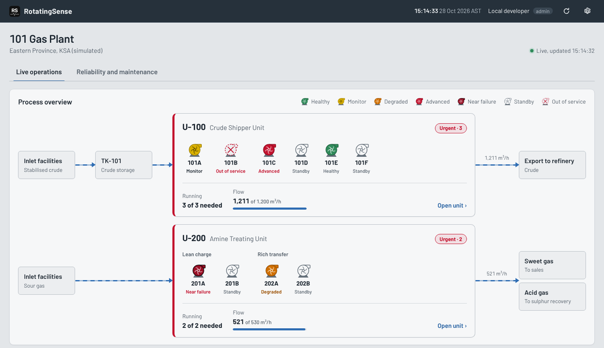
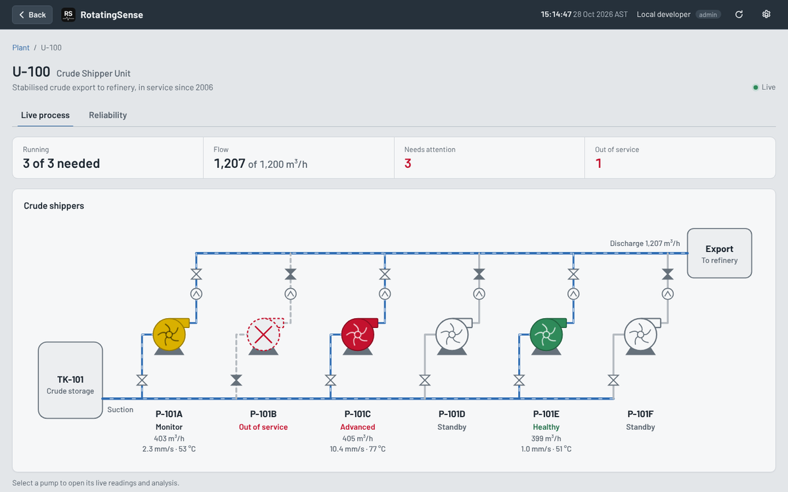
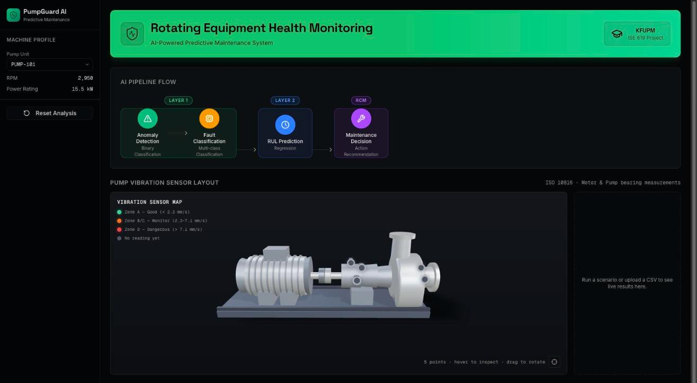

# Luai Al Ibrahim

**Reliability Engineer | RCM & FMEA | CMRP** · MSc Maintenance and Reliability Engineering, KFUPM

I build AI tools for maintenance and reliability of rotating equipment, with a focus on refinery and gas-plant pumps. Two projects, one idea: turn vibration and process data into decisions a maintenance team can act on.

---

## 1. RotatingSense: plant-level predictive maintenance

**[Open RotatingSense](https://rotatingsense.onrender.com)**: live demo (sign-in required; message me for a demo account).

A web platform that takes the V0 pump model (below) from a single pump to a whole plant. It follows the way a plant is organised: **plant → unit → pump**.

- **Plant overview:** live process map, pumps running against pumps needed, flow against demand, and a ranked "needs attention" list.
- **Unit page:** live P&ID of the pump train with each pump's health state, flow, vibration and bearing temperature.
- **Pump page:** 3D model with sensor readings, trends, diagnosis, RCA, FMEA and RCM.
- **Five health states, one palette:** Healthy, Monitor, Degraded, Advanced, Near failure. They look the same on every page.
- **Alarms come from measured values only (ISA-18.2).** The AI explains and recommends on request; it never raises an alarm.
- **Reliability analytics:** Weibull, MTBF, MTTR, availability, bad actors, PM compliance.
- **Failure stories:** 11 researched pump failure scenarios (cavitation, seal flush, misalignment and others) that change the process readings.
- **Same results as V0:** the PumpGuard v6.1 models are unchanged, checked by a parity test (55 cases, 0 differences).
- **Quality:** 185 automated tests plus a screen audit at phone, tablet and desktop sizes.

All plant data is **simulated**. Built with FastAPI, Supabase Postgres, React, Vite and react-three-fiber.

---

## 2. V0 (PumpGuard AI v6.1): AI pipeline for pump health

**[Open V0](https://portly-chi.vercel.app)**: public demo, no sign-in. Pick a pump, upload vibration data or run a scenario.

My MSc project (ISE 619, KFUPM): a three-stage machine-learning pipeline for centrifugal pumps.

- **Anomaly detection** (Isolation Forest), then **fault classification** (XGBoost: normal, misalignment, unbalance, cavitation, coupling failure).
- **Remaining useful life** (LSTM) from run-to-failure bearing data.
- **RCM decision:** the result is turned into a maintenance recommendation, not only a score.
- **3D sensor map** coloured by ISO 10816 vibration zones.
- Trained on public datasets (NLN-EMP and XJTU-SY). It is an academic proof of concept, designed to be retrained on a plant's own data.

---

### Contact
Reliability Engineer, Saudi Arabia · CMRP · RCM · FMEA
